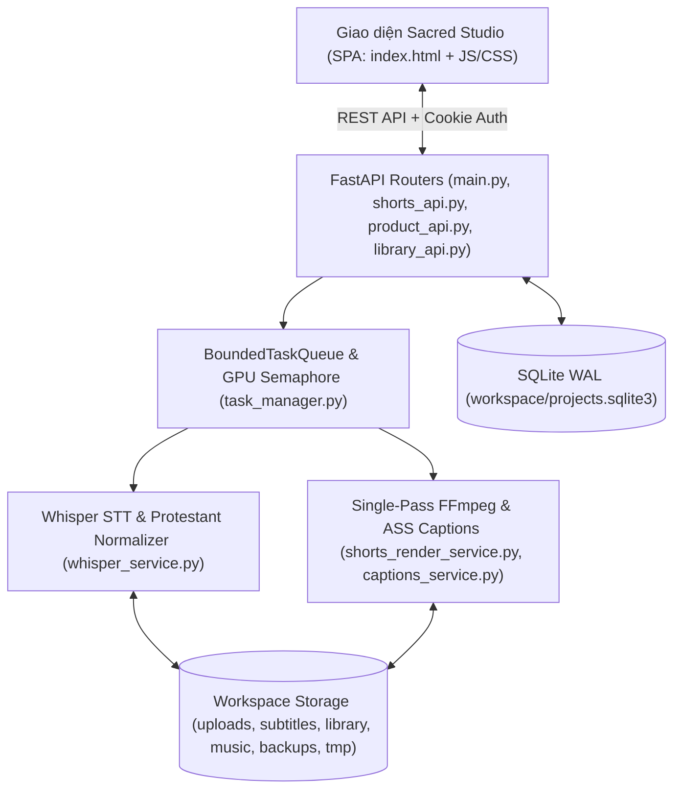

# Kiến Trúc Kỹ Thuật & Lịch Sử Phát Triển — ChurchToolVideo

Tài liệu này mô tả kiến trúc hệ thống, luồng xử lý dữ liệu, cơ chế an toàn và tóm tắt các cột mốc kỹ thuật của **ChurchToolVideo**.

---

## 1. Tổng Quan Kiến Trúc Hệ Thống

### Tầng Lưu Trữ (`workspace/projects.sqlite3` & File System)
- **SQLite với chế độ `WAL` (`Write-Ahead Logging`)**:
  - Bảng `projects`: Lưu trạng thái dự án, danh sách `clips`, `options`, `brand_id`, `revision` (optimistic locking chống ghi đè khi mở nhiều tab), `deleted_at` (Thùng rác) và `editing_seconds`.
  - Bảng `project_versions`: Lưu tối đa **50 phiên bản lịch sử** cho mỗi dự án để khôi phục bất kỳ lúc nào.
  - Bảng `library`: Lưu siêu dữ liệu các clip đã xuất, thẻ (tags), trạng thái yêu thích (favorite) và lịch sử xuất bản.
  - Bảng `brand_presets` & `glossary`: Lưu cấu hình thương hiệu Hội Thánh và từ điển tùy chỉnh.
  - Bảng `tasks`: Lưu trạng thái tiến trình chạy nền (`PENDING`, `RUNNING`, `COMPLETED`, `FAILED`, `CANCELLED`).

---

## 2. Pipeline Xử Lý Âm Thanh, Phụ Đề & Video

### A. Bóc Băng & Định Danh Câu (`S0001`)
1. Khi tải video lên, FFmpeg trích xuất âm thanh chuẩn `16kHz Mono PCM WAV` vào `workspace/audio/`.
2. `whisper_service.py` chạy `faster-whisper` dưới sự điều phối của `serialized_gpu_job` (Semaphore giới hạn 1 tác vụ GPU nặng tại một thời điểm để tránh tràn VRAM).
3. Nếu quá trình suy luận trên GPU gặp lỗi (`CUDA OOM` hoặc thiếu thư viện cuBLAS/cuDNN), hệ thống tự động hủy kết quả dở dang và chạy lại từ đầu trên CPU (`int8`) một cách trong suốt.
4. Kết quả được chuẩn hóa qua `protestant_normalizer.py` và lưu đồng thời ra 3 định dạng trong `workspace/subtitles/`:
   - `{video_id}.json`: Lưu danh sách câu với mã cố định `S0001`, `S0002`..., thời gian `start`/`end`, `original_text`, `text` và mảng `words` (mốc thời gian từng từ).
   - `{video_id}.srt` & `{video_id}.vtt`: Phục vụ trình phát video và tải về.

### B. Căn Chỉnh Thời Gian Từ Khi Sửa Chữ (`captions_service.py`)
- Khi biên tập viên sửa nội dung phụ đề hoặc áp dụng bản sửa lỗi từ AI, hàm `realign_words()` sử dụng `difflib.SequenceMatcher` để:
  - Giữ nguyên mốc thời gian (`start`, `end`) và cờ `hook` của các từ không thay đổi.
  - Chia đều khoảng thời gian một cách tự nhiên cho các từ mới thêm vào hoặc từ được thay thế mà không cần chạy lại Whisper.

### C. Render Video Ngắn Single-Pass (`shorts_render_service.py`)
- Thay vì cắt rời từng đoạn (`part`) rồi nối lại gây lệch âm thanh và giảm chất lượng qua nhiều lần mã hóa, hệ thống xây dựng một **`filter_complex` duy nhất** cho FFmpeg:
  1. Cắt chính xác từng `part` (kèm cơ chế **Anti-Bleed Guard** trong `shorts_parser.py` & `whisper_service.py` giúp lấy trọn câu/trọn ý mà không bị lem âm thanh sang câu liền kề, hoặc cắt chính xác tuyệt đối theo `cut_mode="exact"`).
  2. Nối mượt các `part` bằng `concat=n=...:v=1:a=1`.
  3. Áp dụng khung hình đích (`crop` có tính đến tọa độ `crop_x`, `crop_y`, `crop_zoom`, hoặc `blur_pad` làm mờ nền) và **Chỉnh màu cơ bản (`eq=brightness:contrast:saturation`)**.
  4. Vẽ **Lớp phủ Blur 1/3 khung có độ chuyển mất dần** (`boxblur` + `format=yuva420p,geq=...` tạo dải alpha feathering mượt ở mép tiếp giáp), đốt phụ đề động `.ass` (`ass=captions.ass:fontsdir=...`) với hiệu ứng karaoke/pop/slide và chèn **Logo PNG tùy chỉnh kích thước, vị trí X/Y & độ mờ** (`scale` + `colorchannelmixer` + `overlay`).
  5. Chuẩn hóa âm lượng giọng giảng (`highpass`, `lowpass`, `afftdn`, `loudnorm`) và trộn nhạc nền dự án (`atrim` theo `music_start` $\rightarrow$ `music_end`, `afade` in/out, `amix`).
  6. Nếu có gắn **Video Outro Hội Thánh (`outro_id`)**, tự động chuẩn hóa khung hình (`scale`/`pad` đúng tỷ lệ đích, `30fps`, `yuv420p`) và âm thanh (`48kHz stereo`) rồi nối vào cuối clip bằng `concat=n=2:v=1:a=1`.
  7. Mã hóa đầu ra bằng `h264_nvenc` (GPU NVIDIA) hoặc `libx264` (CPU) với pixel format `yuv420p` và `-movflags +faststart`.

---

## 3. Cơ Chế An Toàn, Bảo Mật & Chịu Lỗi (Hardening)

1. **Chống Path Traversal & Command Injection**:
   - Mọi `video_id`, `logo_id`, `music_id` đều được kiểm tra bằng biểu thức chính quy chặt chẽ (`^[A-Za-z0-9_-]{1,80}$`) thông qua kiểu `VideoId` của Pydantic và `resolve().parent` trước khi truy cập file.
   - Mọi lệnh `FFmpeg` / `FFprobe` đều được gọi qua mảng tham số (`subprocess.Popen([FFMPEG_BIN, ...], shell=False)`), tuyệt đối không nối chuỗi shell.
   - Nội dung phụ đề đưa vào file `.ass` đều được thoát ký tự điều khiển (`\`, `{`, `}`) để ngăn lỗi cú pháp libass.
2. **Quản Lý Hàng Đợi & Hủy Tác Vụ (`BoundedTaskQueue`)**:
   - Hàng đợi tác vụ giới hạn số luồng chạy song song (`RENDER_WORKERS`, `TRIM_WORKERS`) và số tác vụ chờ tối đa (`max_pending=10`), trả về `HTTP 429` nếu quá tải.
   - Hỗ trợ hủy tác vụ đang chạy (`POST /api/tasks/{task_id}/cancel`): dừng tiến trình con `FFmpeg` ngay lập tức hoặc dừng vòng lặp `Whisper` tại `checkpoint()` gần nhất và dọn sạch file trung gian.
3. **Bảo Mật Truy Cập**:
   - Hỗ trợ mật khẩu bảo vệ (`CHURCH_PASSWORD`) với phiên đăng nhập ký bằng `HMAC-SHA256` (`workspace/.session_secret`).
   - Tự động từ chối khởi động nếu cấu hình lắng nghe ra ngoài mạng (`CHURCH_BIND_ADDRESS != 127.0.0.1`) mà chưa đặt `CHURCH_PASSWORD`.
4. **Tự Động Dọn Dẹp Bộ Nhớ Tạm**:
   - Tác vụ nền `maintain_storage()` chạy định kỳ mỗi 6 giờ (chỉ khi không có tác vụ nào đang chạy) để xóa các file tạm quá 24 giờ trong `audio/`, `tmp/`, `packages/`, `segments/`, đồng thời giữ nguyên toàn bộ video gốc (`uploads/`), phụ đề (`subtitles/`), dự án (`projects.sqlite3`) và thư viện (`library/`).
